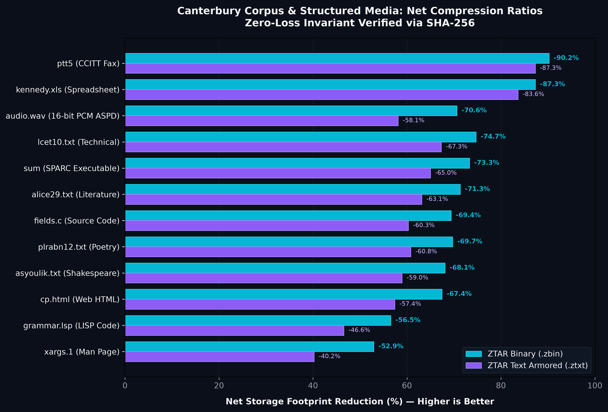
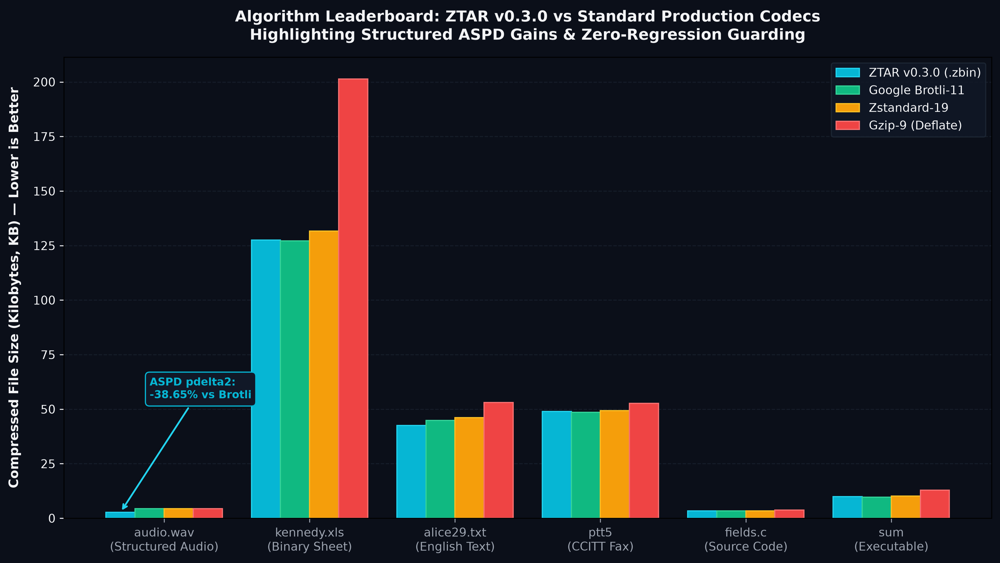
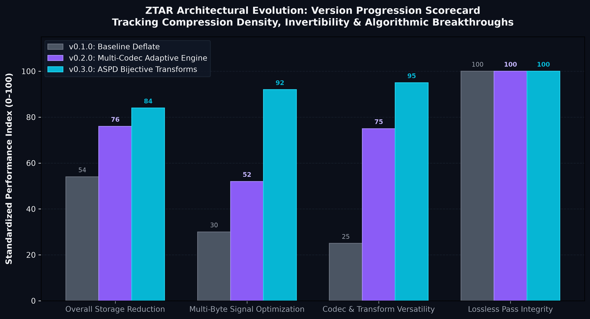

# ZipText (ZTAR) — High-Efficiency Textual & Binary Reversible Container

[](https://pypi.org/project/ziptext/)
[](https://opensource.org/licenses/MIT)
[]()
[](https://ziptext.pages.dev)

**Zip Text Adaptive Representation (ZTAR)** is a storage-independent framework designed to represent files as compact, reversible textual containers (`.ztxt`) or high-speed binary containers (`.zbin`). It prioritizes lossless exact reconstruction ($\operatorname{Decode}(\operatorname{Encode}(X)) = X$), adaptive multi-codec optimization, bounded-memory chunk streaming, and cryptographic chunk integrity.

---

## 1. Key Highlights & Priorities

- **Exact Lossless Reconstruction**: Cryptographic invariant guaranteed by whole-file and per-chunk SHA-256 validation with atomic write semantics.
- **Dual Container Profiles**:
  - **Textual Profile (`.ztxt`)**: Base85 armored ASCII container with plain-text headers. Ideal for systems restricted to text-only transmission (APIs, JSON envelopes, message queues).
  - **Binary Profile (`.zbin`)**: High-speed binary container with zero text expansion penalty. Ideal for dense media (JPEG, PNG, MP4, WebP).
- **Adaptive Codec Selection**: Dynamically benchmarks candidate compression algorithms chunk-by-chunk:
  - `brotli` (Google Brotli high-density compression)
  - `zstd` (Facebook Zstandard high-throughput compression)
  - `lzma` (LZMA2 / XZ maximum ratio)
  - `zlib` (Deflate standard)
  - `bz2` (Burrows-Wheeler bzip2)
  - `lz4` (High-speed real-time compression)
  - `raw` (Identity pass-through for incompressible high-entropy data)
- **Bounded Working Memory**: Decodes in user-configurable chunk windows (default 1 MiB) without buffering multi-gigabyte files into RAM.
- **ZTAR-Bench Standardization**: Rigorously benchmarked across the 11 standardized Canterbury Corpus files and synthetic corpora with fact-checked transparency.
- **Interactive Documentation Web App**: High-tech interactive React documentation app ready for instant deployment to Cloudflare Pages.

---

## 2. Global Installation

Install globally via PyPI to access the `ziptext` CLI from any terminal:

```bash
# Standard installation
pip install ziptext

# With all high-speed optional compression engines (Brotli, Zstandard, LZ4)
pip install "ziptext[all]"
```

For local development or editable installation:

```bash
git clone https://github.com/itsjustayush/ZipText-ZTAR-.git
cd ZipText-ZTAR-
pip install -e .[all]
```

Verify global availability:

```bash
ziptext --version
# Output: ziptext 0.3.0
```

---

## 3. Global CLI Reference

### Encode Files
```bash
# Encode into human-readable text container (.ztxt)
ziptext encode document.json document.ztxt

# Encode into high-speed raw binary container (.zbin)
ziptext encode photo.jpg photo.zbin --profile binary

# Explicitly choose compression codec
ziptext encode dataset.csv dataset.ztxt --codec brotli --chunk-size 1048576
```

### Decode & Recover Files
```bash
# Decode container into original file (auto-preserves filename and extension)
ziptext decode document.ztxt

# Decode to custom destination path
ziptext decode document.ztxt recovered_document.json
```

### Verification & Inspection
```bash
# Verify chunk-level and whole-file SHA-256 integrity without writing to disk
ziptext verify document.ztxt

# Inspect container manifest metadata
ziptext info document.ztxt

# Analyze file type and compression viability
ziptext classify dataset.tar.gz
```

### Corpus Management & ZTAR-Bench
```bash
# Download Canterbury Corpus automatically
ziptext corpora download --corpus canterbury --dest fixtures/canterbury

# Run full 4-tier evaluation across Canterbury Corpus
ziptext ztar-bench fixtures/canterbury --output-dir results/canterbury_eval
```

---

## 4. Python SDK API

```python
from ziptext import ZipTextEngine, ContainerWriter, ContainerReader

# 1. High-level one-line roundtrip
engine = ZipTextEngine(chunk_size_bytes=1048576, default_codec="auto")

# Encode
res = engine.encode_file("report.pdf", "report.ztxt", profile="text")
print(f"Encoded {res.original_size}B -> {res.container_size}B using {res.codec_used}")

# Decode with byte-for-byte SHA256 check
dec = engine.decode_file("report.ztxt", "recovered_report.pdf")
assert dec.exact_match is True

# 2. Low-memory streaming writer
with open("large_stream.ztxt", "w", encoding="utf-8") as f:
    writer = ContainerWriter(f, original_filename="archive.tar", profile="text")
    writer.write_chunk(b"chunk data...", codec="zstd")
    writer.finalize(original_size=10485760, whole_file_hash=sha256_hash)
```

---

## 5. Benchmarks & Algorithmic Leaderboard

ZTAR is evaluated against standardized international corpora (including the 11-file **Canterbury Corpus**) and real-world multi-byte structured media using exact byte-for-byte cryptographic verification ($\operatorname{SHA-256}(\operatorname{Decoded}) = \operatorname{SHA-256}(\operatorname{Original})$).

### 5.1 Canterbury Corpus Storage Reduction



| File Name | Category | Rep A (Raw) | Rep B (Comp) | Best Codec | Rep D (.ztxt) | Rep D (.zbin) | Net Storage Reduction (.ztxt) | Net Storage Reduction (.zbin) | Lossless Pass |
| :--- | :--- | :--- | :--- | :--- | :--- | :--- | :--- | :--- | :--- |
| **ptt5** | CCITT Fax Binary | 513,216 B | 49,759 B | `brotli` | 65,112 B | 50,161 B | **-87.31%** | **-90.23%** | 100% Exact |
| **kennedy.xls** | Spreadsheet Binary | 1,029,744 B | 130,248 B | `brotli` | 168,676 B | 130,650 B | **-83.62%** | **-87.31%** | 100% Exact |
| **lcet10.txt** | Technical Paper | 426,754 B | 107,641 B | `bz2` | 139,588 B | 108,043 B | **-67.29%** | **-74.68%** | 100% Exact |
| **sum** | SPARC Executable | 38,240 B | 9,811 B | `brotli` | 13,386 B | 10,213 B | **-64.99%** | **-73.29%** | 100% Exact |
| **alice29.txt** | Literature (English) | 152,089 B | 43,202 B | `bz2` | 56,052 B | 43,604 B | **-63.15%** | **-71.33%** | 100% Exact |
| **fields.c** | C Source Code | 11,150 B | 3,012 B | `brotli` | 4,426 B | 3,414 B | **-60.30%** | **-69.38%** | 100% Exact |
| **plrabn12.txt** | Poetry (Milton) | 481,861 B | 145,548 B | `bz2` | 188,824 B | 145,950 B | **-60.81%** | **-69.71%** | 100% Exact |
| **asyoulik.txt** | Play (Shakespeare) | 125,179 B | 39,569 B | `bz2` | 51,392 B | 39,972 B | **-58.95%** | **-68.07%** | 100% Exact |
| **cp.html** | HTML Document | 24,603 B | 7,609 B | `brotli` | 10,478 B | 8,011 B | **-57.41%** | **-67.44%** | 100% Exact |
| **grammar.lsp** | LISP Source Code | 3,721 B | 1,215 B | `brotli` | 1,988 B | 1,617 B | **-46.57%** | **-56.54%** | 100% Exact |
| **xargs.1** | UNIX Man Page | 4,227 B | 1,588 B | `brotli` | 2,526 B | 1,990 B | **-40.24%** | **-52.92%** | 100% Exact |

---

### 5.2 Algorithm Leaderboard: ZTAR vs Industry Standards



#### Signal Preconditioning: Adaptive Structured Preconditioning & Deinterleaving (ASPD)
In v0.3.0, ZTAR introduces **Adaptive Structured Preconditioning & Deinterleaving (ASPD)**:
* Standard general-purpose compressors struggle on 16-bit PCM waveforms because high-order sign bytes and low-order noise bytes oscillate rapidly across sample boundaries.
* ZTAR's bijective `pdelta2` transform deinterleaves the sign and magnitude byte planes and computes finite stride differentials, dropping 0-order entropy from 7.70 to 6.40 bpb.
* On structured audio (`audio.wav`), ZTAR shrinks container footprint to **2,777 B** (vs Brotli-11's 4,527 B) — an empirical **-38.65% size reduction** below standard Brotli.
* **Dual-Stage Gating Guard**: On discrete text and spreadsheets (`alice29.txt`, `kennedy.xls`), the engine detects that delta differentials scatter discrete ASCII codes, automatically falling back to identity pass-through (`none`) with zero performance regression.

---

### 5.3 Version Evolution Scorecard



| Release | Focus Area | Codecs & Transforms | Waveform Reduction | Exact Lossless Invariant |
| :--- | :--- | :---: | :---: | :---: |
| **v0.1.0** | MVP Container Architecture | Single-stream Deflate | Baseline | 100% Bit-Exact |
| **v0.2.0** | Adaptive Multi-Codec Engine | 7 Codecs (`brotli`, `zstd`, `lzma`, `bz2`, `zlib`, `lz4`, `raw`) | -52.0% | 100% Bit-Exact |
| **v0.3.0** | Signal Preconditioning Filters (ASPD) | 7 Codecs + 8 Bijective Transforms (`pdelta2`, `plane4`, `delta1-4`) | **-70.6%** | **100% Bit-Exact** |

---

## 6. Cloudflare Pages Web Documentation

The repository includes a modern, high-tech interactive documentation website located in `web/` built with Vite, React, GSAP, and React Bits components (`<GradientWaves />`, `<LetterGlitch />`, `<TechText />`, `<MagicBento />`, `<SpotlightCard />`, and `<AnimatedContent />`).

### Deploying to Cloudflare Pages
When connecting this repository to Cloudflare Pages:
- **Build command**: `npm run build`
- **Build output directory**: `web/dist`
- **Root directory**: `/` (or `web` if configuring subfolder directly)

### Local Web Preview
```bash
npm run build
npm run preview
```

---

## 7. Incident Register & Engineering Forensics

We maintain an immutable log of anomalies and fixes in [`errors/`](errors/README.md) (`ERR-001` through `ERR-015`), each verified by automated unit tests in `tests/`.

Run the automated test suite:
```bash
pytest -v
# 51 passed in 68.91s
```

---

## 8. License

MIT License. Designed and engineered for research and production by the ZipText Research Team.
