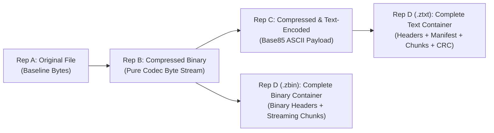

# ZTAR-Bench v1.0 — Benchmark Standard & Evaluation Specification

This specification defines the official benchmarking framework, competitive baseline criteria, dataset acquisition pipelines, and evaluation standards for the Zip Text Adaptive Representation (ZTAR) engine.

---

## 1. Core Evaluation Philosophy

No single dataset or single metric can certify a compression engine across all file types, memory limits, and transport environments. The ZTAR evaluation standard is built on three foundational pillars:
1. **Strict Bit-for-Bit Preservation Invariant:** In lossless mode, $\operatorname{Decode}(\operatorname{Encode}(X)) = X$. Exact SHA-256 and byte equality are non-negotiable. Identical-looking images or perceptually similar audio do not satisfy lossless claims.
2. **Two-Tier Format Compliance:** Decoded media assets must pass deep parser audits (e.g. Pillow for images, ISO-BMFF for video, RIFF for audio, OpenXML for Office) ensuring files open cleanly in standard system players.
3. **The 4-Representation Decomposition:** Disentangles compression capability from text-serialization penalties and container framing overhead.

---

## 2. The 4-Representation Model

To provide complete transparency on whether an algorithm is truly improving compression or simply incurring serialization overhead, ZTAR measures four distinct representations for every file:



1. **Representation A (Original File, $S_A$):** Raw input byte size.
2. **Representation B (Compressed Binary, $S_B$):** Pure output of the compression algorithm without any container or text framing. Demonstrates raw mathematical redundancy reduction.
3. **Representation C (Compressed & Text-Encoded, $S_C$):** The compressed binary serialized to Base85 ASCII text. Isolates the mathematical text penalty ($+25\%$ overhead).
4. **Representation D (Complete ZTAR Container, $S_D$):**
   - **$S_{D,\text{ztxt}}$:** Includes human-readable manifest, chunk headers, chunk index, CRC32, and SHA-256 digests.
   - **$S_{D,\text{zbin}}$:** Compact binary container eliminating Base85 overhead for high-entropy media.

---

## 3. Essential Benchmark Datasets

ZTAR evaluates against 6 established data corpora:

### 1. Mixed Files & General Lossless Compression
- **Canterbury Corpus:** Reference collection for lossless compression (text, source code, spreadsheets, executables).
  - *URL:* `https://corpus.canterbury.ac.nz/`
  - *Status in ZTAR:* Automated downloader available via `ziptext.corpora.CorporaManager.fetch_canterbury_corpus()`.
- **Silesia Corpus:** 12 larger, diverse files (211 MB total) including databases, binary executables, medical imagery, and dictionaries. Used by LZ4 and Zstandard official leaderboards.
  - *URL:* `https://mattmahoney.net/dc/silesia.html`

### 2. Photographic & Visual Images
- **Kodak Photographic Suite:** 24 uncompressed true-color photographic images (768x512).
- **Tecnick Image Dataset:** 100 high-resolution (1200x1200) photographic assets.
- **CLIC (Challenge on Learned Image Compression):** Research images with diverse natural redundancy.
  - *Requirement:* Must test exact byte-for-byte image container recovery, not merely lossy PSNR/SSIM reconstruction.

### 3. Video Containers & Sequences
- **Xiph.Org Test Media:** Uncompressed Y4M/YUV and lossless media samples.
- **UVG Dataset (Ultra Video Group):** 16 4K sequences at 50/120 fps for measuring inter-frame and spatial redundancies.
  - *Evaluation Note:* Measures performance on raw uncompressed frames versus pre-compressed MP4/H.264 streams.

### 4. Audio Streams
- **Xiph Test Audio / FLAC Test Suite:** Lossless PCM audio across varied acoustic complexities.
- **Mozilla Common Voice:** Multi-speaker speech audio in MP3 and WAV containers.

### 5. PDFs & Structured Documents
- **arXiv Bulk Dataset:** Research paper PDFs with embedded fonts, vector equations, and compressed streams.

### 6. Large-Scale Textual Corpora
- **Large Text Compression Benchmark (enwik8 / enwik9):** 100 MB and 1 GB Wikipedia XML extracts.
- **Common Crawl:** Real-world HTML, JSON, and web-derived text.

---

## 4. Competitive Baseline Configurations

To prove competitive superiority, ZTAR benchmarks against 7 established industry configurations on identical hardware:

| Baseline Codec | Implementation | Setting / Level | Focus Area |
| :--- | :--- | :---: | :--- |
| **No Compression** | Raw Identity | N/A | Absolute size floor |
| **GZIP / zlib** | `zlib` (RFC 1950) | Level 6 & Level 9 | Universal baseline |
| **Zstandard (zstd)** | `zstandard` | Level 3 (Speed) & Level 19 (Ultra) | High throughput & modern ratios |
| **LZ4** | `lz4.frame` | Default (Level 0) | Ultra-fast low latency decompression |
| **Brotli** | `brotli` | Quality 11 | Web text & source code compression |
| **LZMA / XZ** | `lzma` (Preset 6 & 9) | High compression | Maximum non-neural compaction |
| **ZIP Archive** | `zipfile` DEFLATE | Standard | Standard end-user packaging comparison |

---

## 5. ZTAR-Bench v1.0 Composition

ZTAR-Bench v1.0 standardizes test weightings across 6 functional domains:

```
┌─────────────────────────────────────────────────────────────┐
│                   ZTAR-Bench v1.0 (100%)                    │
├──────────────┬──────────────┬──────────────┬────────────────┤
│ Text & Code  │ Images       │ Video        │ Audio          │
│ 20%          │ 20%          │ 20%          │ 15%            │
├──────────────┴──────────────┼──────────────┴────────────────┤
│ Documents & Archives (15%)  │ Binary & Synthetic Controls (10%)│
└─────────────────────────────┴───────────────────────────────┘
```

- **20% Text & Code:** JSON, CSV, XML, YAML, HTML, Python, JS, C, Markdown, Server Logs.
- **20% Images:** Uncompressed BMP, PNG, photographic JPEG, modern WebP, animated GIF, vector SVG.
- **20% Video:** ISO-BMFF MP4 (H.264/AAC), WebM (VP9/Opus), uncompressed Y4M.
- **15% Audio:** Linear PCM WAV, FLAC lossless, MP3 speech & music.
- **15% Documents & Archives:** PDF, Word DOCX, Excel XLSX, ZIP bundles, TAR.GZ.
- **10% Binary & Synthetic Controls:** Compiled PE executables (`.exe`), zero-filled buffers, high-entropy random noise.

---

## 6. Official Metrics & Reporting Protocol

For every evaluated test case, the benchmark captures:
1. **Final Representation Size ($S_{\text{final}}$):** All container headers, chunk framing, and Base85 text overhead counted.
2. **Storage Reduction Percentage:**
   $$\text{Reduction} = 100 \times \left(1 - \frac{S_{\text{final}}}{S_{\text{original}}}\right)\%$$
   *(Negative values indicate container/text expansion).*
3. **Compression Throughput:** Original megabytes processed per second ($\text{MB/s}$).
4. **Decompression Throughput:** Reconstructed megabytes produced per second ($\text{MB/s}$).
5. **Peak Working Memory (RSS):** Maximum resident set size in KiB during execution.
6. **Bit-for-Bit Exact Verification:** $\text{SHA-256}(X_{\text{orig}}) \stackrel{?}{=} \text{SHA-256}(X_{\text{rec}})$.
7. **Semantic Media Validation:** Standard file parser integrity status (`MediaValidator`).

---

## 7. Open Publication & Reproducibility Plan

1. **GitHub Repository:** Code, CLI runner, corpus manifests, and unit tests published openly.
2. **Kaggle Datasets:** Curated open-licensed test samples, ground-truth SHA-256 manifests, and CSV leaderboards.
3. **Hugging Face Datasets:** Versioned dataset card detailing collection methodology, licenses, and benchmark splits.
4. **Zenodo Research Archive:** Permanent citable releases with Digital Object Identifiers (DOI).
