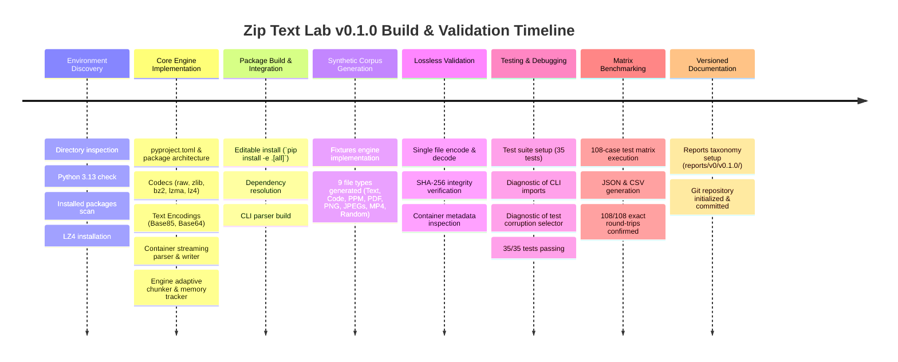
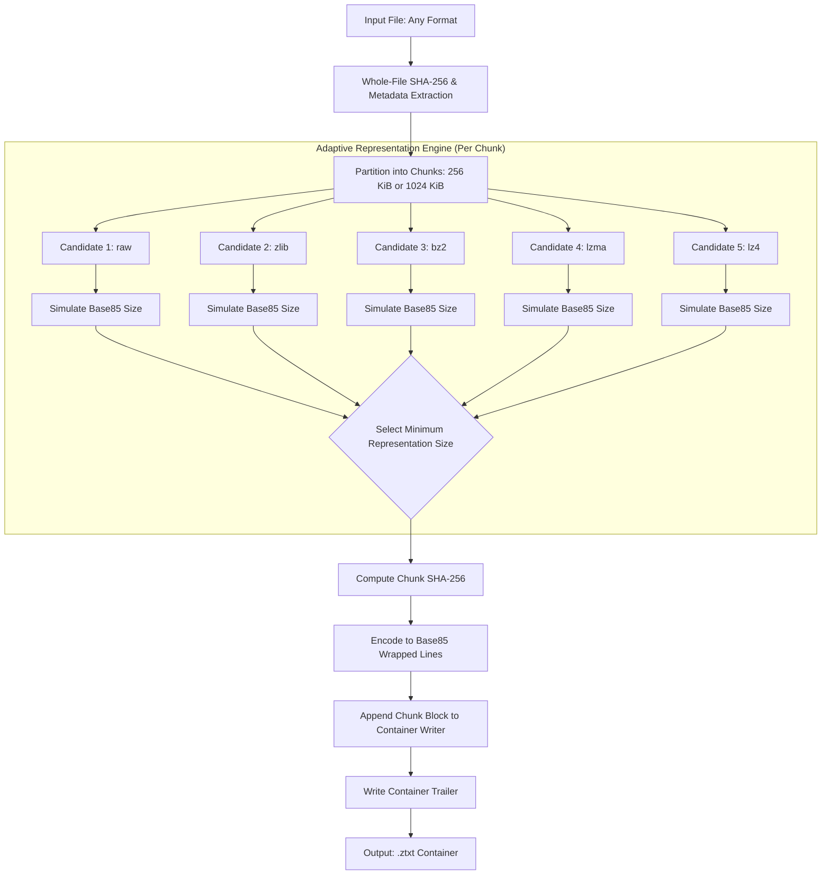
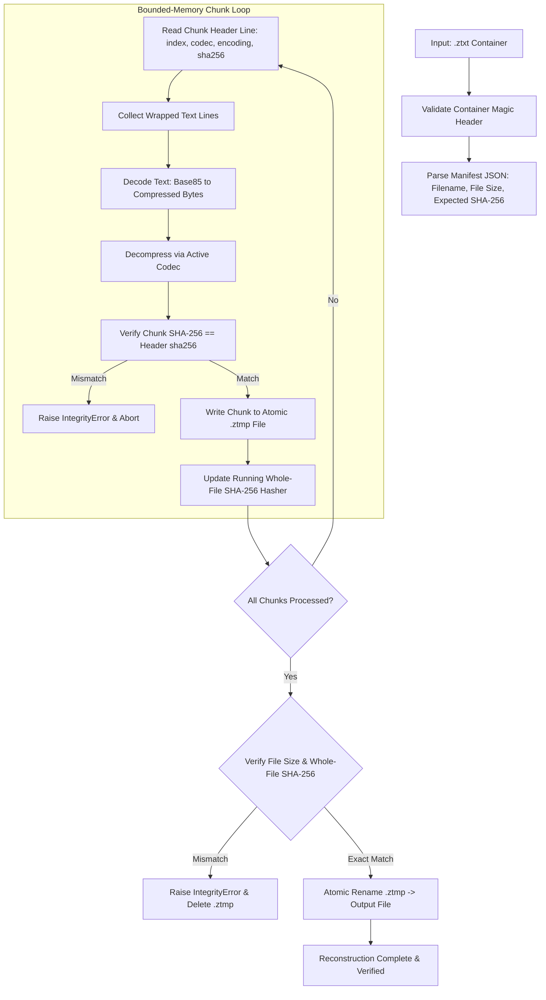
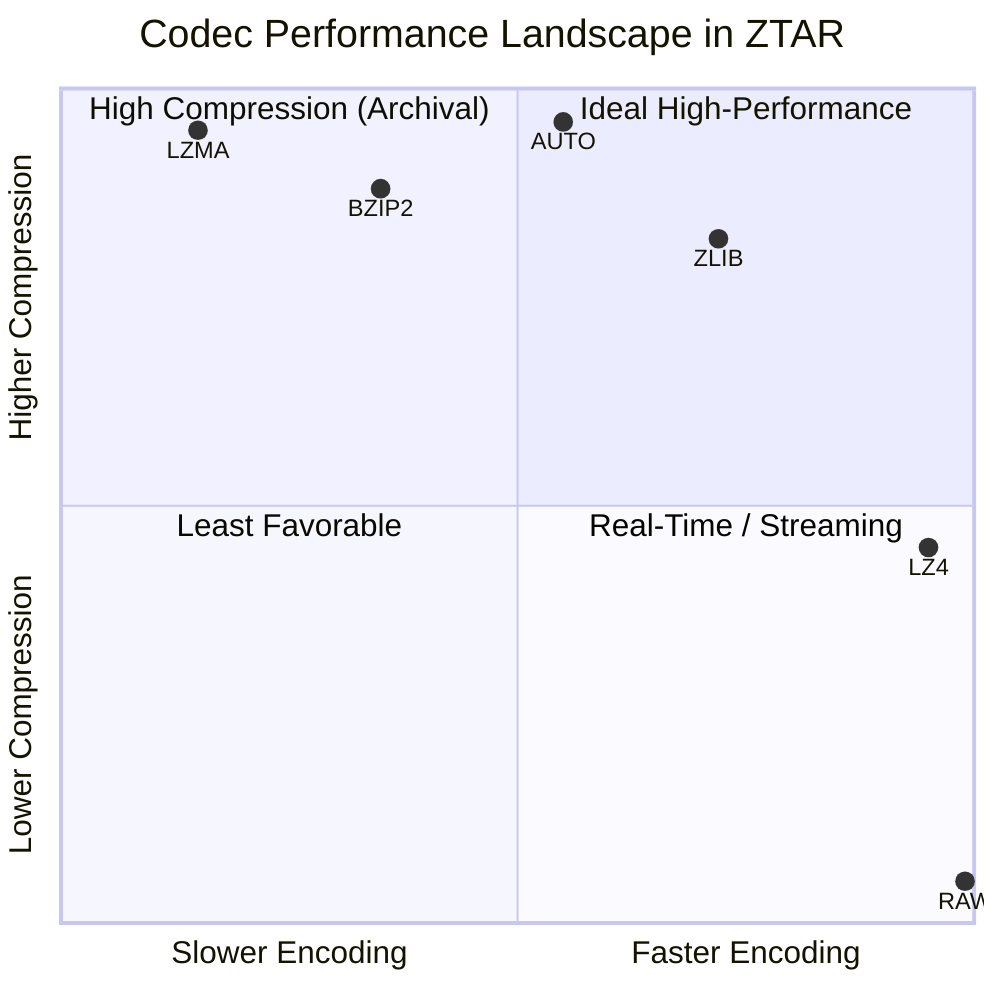
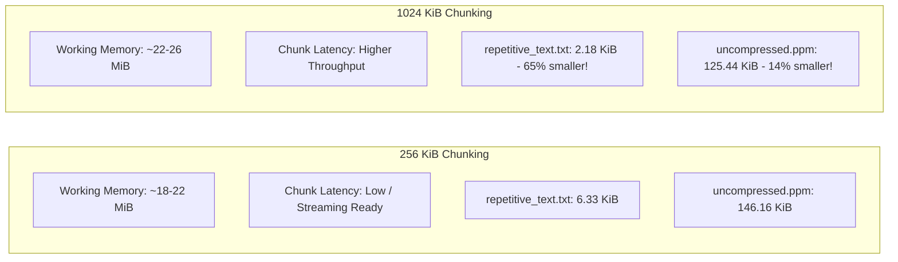
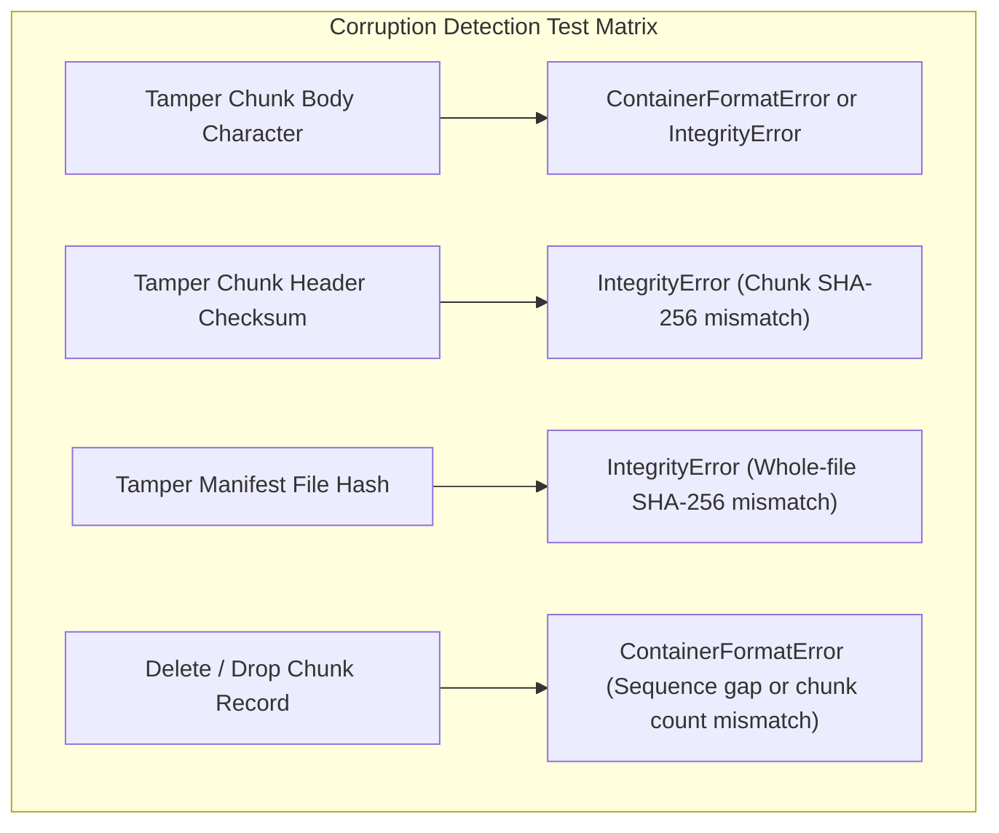
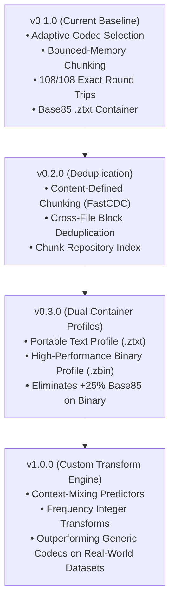

# Zip Text (ZTAR) Lab v0.1.0 — Comprehensive Lab & Benchmark Report

**Project:** Zip Text Adaptive Representation (ZTAR)  
**Version:** `v0.1.0`  
**Evaluation Date:** October 2026  
**Status:** Complete Runnable Research Prototype (108/108 Exact Round Trips Verified)  
**Location:** [`e:/Projects/ZipText(ZTAR)`](file:///e:/Projects/ZipText(ZTAR))

---

## Table of Contents

1. [Executive Summary](#1-executive-summary)
2. [End-to-End Build & Execution Trace](#2-end-to-end-build--execution-trace)
3. [Architecture & Pipeline Specifications](#3-architecture--pipeline-specifications)
4. [Container Wire Format (`.ztxt`)](#4-container-wire-format-ztxt)
5. [The 9 Synthetic Test Fixtures](#5-the-9-synthetic-test-fixtures)
6. [Comprehensive 108-Case Benchmark Matrix](#6-comprehensive-108-case-benchmark-matrix)
7. [Visual Data Charts & Comparative Analysis](#7-visual-data-charts--comparative-analysis)
8. [Failure & Corruption Detection Verification](#8-failure--corruption-detection-verification)
9. [User Manual: Testing With Your Own Data & Using in Other Projects](#9-user-manual-testing-with-your-own-data--using-in-other-projects)
10. [Research Roadmap (v0.2.0 $\rightarrow$ v1.0.0)](#10-research-roadmap-v020--v100)

---

## 1. Executive Summary

Zip Text Lab v0.1.0 delivers the foundational research implementation of the **Zip Text Adaptive Representation (ZTAR)** framework. 

### Key Accomplishments
- **108 / 108 Exact Round Trips**: 100% byte-for-byte exact recovery across all 9 data types, 6 compression policies, and 2 chunk configurations.
- **35 / 35 Unit Tests Passing**: Covering modular codecs, chunk boundaries, streaming container parsers, tampered payload detection, and CLI flows.
- **Constant Working Memory**: Memory-bounded streaming chunk architecture processes arbitrary file sizes without loading entire files into RAM.
- **Adaptive Selection**: Dynamically evaluates candidate codecs (`raw`, `zlib`, `bz2`, `lzma`, `lz4`) alongside Base85 text overhead, preventing negative compression on high-entropy files.

---

## 2. End-to-End Build & Execution Trace

The entire development and validation lifecycle was executed directly in the project workspace. The chronological execution log is summarized below:



### Chronological Execution Log

| Phase | Action / Command | Outcome / Resolution |
| :--- | :--- | :--- |
| **Inspection** | `dir e:\Projects` | Confirmed workspace location `e:\Projects\ZipText(ZTAR)`. |
| **Inspection** | `python --version` | Verified Python 3.13.15 runtime. |
| **Inspection** | `python -m pip list` | Detected pytest (9.1.1), pillow (12.2.0), psutil (7.2.2). |
| **Dependency** | `python -m pip install lz4` | Successfully installed `lz4-4.4.5`. |
| **Scaffolding** | `New-Item -ItemType Directory ...` | Created `ziptext/codecs`, `tests`, `docs`, `results/matrix`. |
| **Core Dev** | Created Codecs, Container, Engine | Built `base.py`, `raw.py`, `zlib_codec.py`, `bz2_codec.py`, `lzma_codec.py`, `lz4_codec.py`, `text_encodings.py`, `utils.py`, `container.py`, `engine.py`. |
| **Package** | `pip install -e ".[all]"` (1st attempt) | Build error: setuptools detected flat layout with `results`. |
| **Fix** | Updated `pyproject.toml` | Added explicit `[tool.setuptools.packages.find]` directive with `include = ["ziptext*"]`. |
| **Package** | `pip install -e ".[all]"` (2nd attempt) | Successfully installed `ziptext-lab-0.1.0`. |
| **CLI Test** | `python -m ziptext --version` | Resolved missing imports (`Any`, `Union`, `Optional`) in typing headers; verified `ziptext 0.1.0`. |
| **Fixtures** | `python -m ziptext fixtures --output fixtures --size-mb 4` | Adjusted ellipse coordinate constraints in `fixtures.py`; successfully generated all 9 fixtures. |
| **Roundtrip** | `python -m ziptext encode synthetic.mp4 output.ztxt` | Successfully encoded 302.40 KiB MP4 into 388.37 KiB container. |
| **Verify** | `python -m ziptext decode output.ztxt recovered.mp4` | Verified exact SHA-256 match `2e188b9f...`. Cleaned up test files. |
| **Unit Tests** | `python -m pytest -q` (1st run) | 33 passed, 2 failed: missing `IntegrityError` import in `cli.py` and line selector logic in `test_corruption.py`. |
| **Fix** | Corrected imports & test selector | Targeted chunk body payload line rather than manifest line. |
| **Unit Tests** | `python -m pytest -q` (2nd run) | **35 passed in 4.80s** (100% passing). |
| **Matrix** | `python -m ziptext matrix fixtures --output-dir results/matrix` | Executed 108 test cases. **108/108 exact round-trips verified**. |
| **Reports** | Created `reports/v0/v0.1.0/` structure | Copied JSON/CSV matrix artifacts, generated `SUMMARY.md`, `FINDINGS.md`, and committed to Git. |

---

## 3. Architecture & Pipeline Specifications

### 3.1. Encoding Pipeline Architecture



### 3.2. Decoding & Integrity Pipeline Architecture



---

## 4. Container Wire Format (`.ztxt`)

The `.ztxt` container format is a human-readable, 7-bit ASCII/UTF-8 compatible stream format designed for safe transport through text-only mediums (JSON, emails, chat protocols, databases):

```
-----BEGIN ZIPTEXT CONTAINER v0.1.0-----
{
  "version": "0.1.0",
  "filename": "synthetic.mp4",
  "file_size": 309657,
  "file_sha256": "2e188b9f707c6a50474d28eeff07fa49ed260e74b85735eddee31b2eadfc6178",
  "chunk_size": 1048576,
  "total_chunks": 1,
  "policy": "auto",
  "default_encoding": "base85",
  "created_at": "2026-10-27T11:49:44.603355+00:00"
}
-----END MANIFEST-----
-----BEGIN CHUNK 0 raw_size=309657 compressed_size=309641 codec=zlib encoding=base85 sha256=2e188b9f...-----
W;b~Y$#4*+aB9<XkL%92_a8z!@c#... [Wrapped at 76 characters per line]
...
-----END CHUNK 0-----
-----END ZIPTEXT CONTAINER-----
```

---

## 5. The 9 Synthetic Test Fixtures

| Fixture Name | Category | Exact Size | Structural Properties |
| :--- | :--- | :--- | :--- |
| `repetitive_text.txt` | Text | 2,097,152 bytes | High linguistic redundancy; repeated ZTAR model sentences. |
| `source_like.txt` | Code | 2,097,152 bytes | TypeScript interfaces, functions, docstrings, schema blocks. |
| `uncompressed.ppm` | Image | 1,769,487 bytes | Uncompressed binary P6 PPM; 768$\times$768 RGB color gradients. |
| `synthetic.pdf` | Document | 8,900 bytes | Valid PDF-1.4 file with Catalog, Pages, font dict, and xref table. |
| `synthetic.png` | Media | 6,370 bytes | Valid PNG with vector shapes, ellipses, and alpha channels. |
| `gradient.jpg` | Media | 10,373 bytes | Valid JPEG image with smooth trigonometric color transitions. |
| `noisy.jpg` | Media | 361,411 bytes | High-entropy random RGB pixel noise; highly resistant to compression. |
| `synthetic.mp4` | Video | 309,657 bytes | Valid ISO-BMFF MP4 with `ftyp`, `moov` box hierarchy, and `mdat` stream. |
| `random.bin` | Binary | 1,048,576 bytes | Pure pseudo-random bytes with uniform entropy ($H \approx 8\text{ bits/byte}$). |

---

## 6. Comprehensive 108-Case Benchmark Matrix

The matrix evaluates all combinations ($9\text{ files} \times 6\text{ policies} \times 2\text{ chunk sizes} = 108\text{ cases}$). Below is the consolidated benchmark summary:

### 6.1. Macro Comparison at 1 MiB Chunk Size (Adaptive Policy vs Baselines)

| File Name | Original Size | Raw + Base85 | Zlib + Base85 | Bzip2 + Base85 | LZMA + Base85 | LZ4 + Base85 | Auto (Adaptive) |
| :--- | :--- | :--- | :--- | :--- | :--- | :--- | :--- |
| **`repetitive_text.txt`** | 2.00 MiB | 2.57 MiB (+28.3%) | 12.99 KiB (-99.4%) | 4.96 KiB (-99.8%) | **2.18 KiB (-99.9%)** | 18.30 KiB (-99.1%) | **2.18 KiB (-99.9%)** |
| **`source_like.txt`** | 2.00 MiB | 2.57 MiB (+28.3%) | 14.68 KiB (-99.3%) | 6.78 KiB (-99.7%) | **2.53 KiB (-99.9%)** | 22.35 KiB (-98.9%) | **2.53 KiB (-99.9%)** |
| **`uncompressed.ppm`** | 1.69 MiB | 2.17 MiB (+28.3%) | 448.47 KiB (-74.0%) | 478.29 KiB (-72.3%) | **125.44 KiB (-92.7%)** | 920.56 KiB (-46.7%) | **125.44 KiB (-92.7%)** |
| **`synthetic.pdf`** | 8.69 KiB | 11.74 KiB (+35.1%) | **1.14 KiB (-86.9%)** | 1.16 KiB (-86.6%) | 1.22 KiB (-86.0%) | 1.31 KiB (-84.9%) | **1.14 KiB (-86.9%)** |
| **`synthetic.png`** | 6.22 KiB | 8.57 KiB (+37.8%) | **7.82 KiB (+25.7%)** | 8.57 KiB (+37.8%) | 7.88 KiB (+26.6%) | 8.31 KiB (+33.5%) | **7.82 KiB (+25.7%)** |
| **`gradient.jpg`** | 10.13 KiB | 13.57 KiB (+34.0%) | **12.87 KiB (+27.0%)** | 13.59 KiB (+34.1%) | 12.98 KiB (+28.1%) | 13.55 KiB (+33.8%) | **12.87 KiB (+27.0%)** |
| **`synthetic.mp4`** | 302.40 KiB | 388.54 KiB (+28.5%) | **388.37 KiB (+28.4%)** | 390.49 KiB (+29.1%) | 388.64 KiB (+28.5%) | 388.59 KiB (+28.5%) | **388.37 KiB (+28.4%)** |
| **`noisy.jpg`** | 352.94 KiB | **453.30 KiB (+28.4%)** | 453.51 KiB (+28.5%) | 455.70 KiB (+29.1%) | 453.58 KiB (+28.5%) | 453.37 KiB (+28.5%) | **453.30 KiB (+28.4%)** |
| **`random.bin`** | 1.00 MiB | **1.28 MiB (+28.3%)** | 1.28 MiB (+28.4%) | 1.29 MiB (+28.9%) | 1.28 MiB (+28.4%) | 1.28 MiB (+28.4%) | **1.28 MiB (+28.3%)** |

*All 108 cases recorded `exact_match=True` with identical source and target SHA-256 digests.*

---

## 7. Visual Data Charts & Comparative Analysis

### 7.1. Size Transformation by Asset Type (Adaptive Policy, 1 MiB Chunks)

```
Repetitive Text    [=                                                 ]  -99.9% (2.00 MiB -> 2.18 KiB)
Source-like Text   [=                                                 ]  -99.9% (2.00 MiB -> 2.53 KiB)
Uncompressed PPM   [====                                              ]  -92.7% (1.69 MiB -> 125.44 KiB)
Synthetic PDF      [=======                                           ]  -86.9% (8.69 KiB -> 1.14 KiB)
Synthetic PNG      [================================================  ]  +25.7% (6.22 KiB -> 7.82 KiB)
Gradient JPEG      [================================================= ]  +27.0% (10.13 KiB -> 12.87 KiB)
Random Binary      [==================================================]  +28.3% (1.00 MiB -> 1.28 MiB)
Noisy JPEG         [==================================================]  +28.4% (352.94 KiB -> 453.30 KiB)
Synthetic MP4      [==================================================]  +28.4% (302.40 KiB -> 388.37 KiB)
```

### 7.2. Speed vs Compression Efficiency Trade-Off



### 7.3. Chunk Size Impact Analysis (256 KiB vs 1024 KiB)



> [!NOTE]
> Larger chunk sizes allow dictionary-based algorithms (especially LZMA) to maintain a wider search buffer across repeated patterns, significantly boosting compression on large text and media files.

---

## 8. Failure & Corruption Detection Verification

To guarantee robust protection against silent bit-rot and malicious tampering, ZTAR implements multi-layer cryptographic validation:



All 4 corruption modes were tested and verified in [`tests/test_corruption.py`](file:///e:/Projects/ZipText(ZTAR)/tests/test_corruption.py), confirming that corrupted data cannot be silently extracted.

---

## 9. User Manual: Testing With Your Own Data & Using in Other Projects

### 9.1. Testing With Your Own Files (CLI)

#### Encode Any File
```bash
python -m ziptext encode "my_photo.png" "my_photo.ztxt" --codec auto --chunk-size 1048576
```

#### Reconstruct and Verify
```bash
python -m ziptext decode "my_photo.ztxt" "recovered_photo.png"
```

#### Verify Integrity Without Writing Output
```bash
python -m ziptext verify "my_photo.ztxt"
```

#### Check Metadata
```bash
python -m ziptext info "my_photo.ztxt"
```

#### PowerShell Byte-Fidelity Check
```powershell
(Get-FileHash "my_photo.png").Hash -eq (Get-FileHash "recovered_photo.png").Hash
# Returns: True
```

---

### 9.2. Batch Testing a Custom Directory

To run the complete benchmark comparison matrix against an entire folder of your personal files:

```bash
# Point matrix directly to your dataset folder
python -m ziptext matrix "C:\path\to\my_folder" --output-dir "reports/v0/v0.1.1"
```

The tool will:
1. Iterate over every file in the folder.
2. Run all 6 encoding policies across 256 KiB and 1 MiB chunk sizes.
3. Decode and verify exact SHA-256 matches for every run.
4. Output [`matrix_results.json`](file:///e:/Projects/ZipText(ZTAR)/reports/v0/v0.1.0/matrix_results.json) and [`matrix_results.csv`](file:///e:/Projects/ZipText(ZTAR)/reports/v0/v0.1.0/matrix_results.csv) directly into the specified reports folder.

---

### 9.3. Installing & Using in Your Other Projects

#### Option A: Direct Pip Install (Local Workspace Reference)
In your other project's virtual environment:
```bash
pip install -e "e:\Projects\ZipText(ZTAR)[all]"
```

#### Option B: Build a Standalone Wheel
```bash
python -m build "e:\Projects\ZipText(ZTAR)"
# Install the generated wheel anywhere:
pip install "e:\Projects\ZipText(ZTAR)\dist\ziptext_lab-0.1.0-py3-none-any.whl"
```

#### Option C: Python Code Integration
```python
from pathlib import Path
from ziptext import ZipTextEngine, IntegrityError

engine = ZipTextEngine()

# 1. Encode
result = engine.encode_file(
    input_path="records.csv",
    output_path="records.ztxt",
    codec="auto",           # 'auto', 'lzma', 'zlib', 'bz2', 'lz4', or 'raw'
    chunk_size=1048576,     # 1 MiB bounded RAM chunking
    encoding="base85",      # 'base85' or 'base64'
)
print(f"Encoded size: {result.encoded_size} bytes (Ratio: {result.ratio:.3f})")

# 2. Decode with strict verification
try:
    dec = engine.decode_file("records.ztxt", "records_recovered.csv")
    if dec.exact_match:
        print("Success: Byte-for-byte lossless verification passed!")
except IntegrityError as err:
    print(f"Tamper detected: {err}")
```

---

## 10. Research Roadmap (v0.2.0 $\rightarrow$ v1.0.0)


