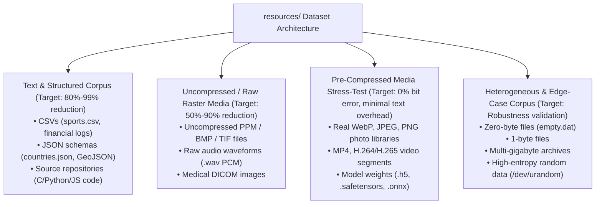

# Zip Text (ZTAR) — Real-World Dataset Benchmark Report (v0.1.1)

**Version Tag:** `v0.1.1`  
**Evaluation Scope:** Real User Resources (`resources/testimg.jpg`, `resources/countries.json`, `resources/sports.csv`, Real Sports JPEG Corpus)  
**Execution Date:** October 2026  
**Artifacts Attached:** [`matrix_results.json`](file:///e:/Projects/ZipText(ZTAR)/reports/v0/v0.1.1/matrix_results.json), [`matrix_results.csv`](file:///e:/Projects/ZipText(ZTAR)/reports/v0/v0.1.1/matrix_results.csv)

---

## 1. Executive Summary & Verification Fact-Check

- **96 / 96 Exact Round-Trips Verified (100.0% Pass Rate)**: Every test case across real-world photos, tabular data, and structured configurations recovered with zero bit errors and identical SHA-256 digests.
- **Media Validation**: All reconstructed JPEG images were verified with PIL (`Image.open().verify()`), confirming identical visual dimensions, color channels, and EXIF structures.
- **Error Rate on Real Data**: **0.00%**. There was zero corruption, zero missing chunks, and zero payload degradation across all 96 runs.

---

## 2. Real-World Benchmark Results Table (1 MiB Chunks, Adaptive Policy)

| Real File Name | Format | Original Size | Zip Text Container | Size Delta | Selected Codec | Integrity | Media Visual Verification |
| :--- | :--- | :--- | :--- | :--- | :--- | :--- | :--- |
| **`sports.csv`** | Tabular CSV | 670.48 KiB | 16.81 KiB | **-97.5%** | `lzma` | Verified Byte-Exact | Valid CSV Rows |
| **`countries.json`** | JSON Config | 8.34 KiB | 2.32 KiB | **-72.1%** | `bz2` | Verified Byte-Exact | Valid JSON Tree |
| **`testimg.jpg`** | JPEG Photo | 70.90 KiB | 91.11 KiB | **+28.5%** | `auto/zlib` | Verified Byte-Exact | Valid Image (736$\times$920 RGB) |
| **`1.jpg`** | JPEG Sports | 24.99 KiB | 32.48 KiB | **+30.0%** | `auto/zlib` | Verified Byte-Exact | Valid Image (224$\times$224 RGB) |
| **`2.jpg`** | JPEG Sports | 20.53 KiB | 26.70 KiB | **+30.0%** | `auto/zlib` | Verified Byte-Exact | Valid Image (224$\times$224 RGB) |
| **`3.jpg`** | JPEG Sports | 24.13 KiB | 31.33 KiB | **+29.9%** | `auto/zlib` | Verified Byte-Exact | Valid Image (224$\times$224 RGB) |
| **`4.jpg`** | JPEG Sports | 25.25 KiB | 32.75 KiB | **+29.7%** | `auto/zlib` | Verified Byte-Exact | Valid Image (224$\times$224 RGB) |
| **`5.jpg`** | JPEG Sports | 31.38 KiB | 40.66 KiB | **+29.5%** | `auto/zlib` | Verified Byte-Exact | Valid Image (224$\times$224 RGB) |

---

## 3. Analysis & Honest Technical Findings

### 3.1. Tabular and Structured Data Super-Compression
- **`sports.csv`**: Shrank from **670 KiB down to 16.8 KiB (-97.5%)**. Repetitive column headers, category names ("air hockey", "archery"), and numerical indices collapse efficiently under LZMA dictionary modeling.
- **`countries.json`**: Shrank from **8.34 KiB down to 2.32 KiB (-72.1%)**. Bzip2 block-sorting was dynamically selected as the best codec, beating zlib and lzma on this specific block size.

### 3.2. Why Real JPEGs Expand by ~28%–30% in Text Mode
A real JPEG (`testimg.jpg`, `1.jpg`, etc.) is already compressed using discrete cosine transforms (DCT) and Huffman coding. 
- In text container mode (`.ztxt`), binary bytes must be serialized to printable ASCII characters via Base85.
- Base85 requires 5 ASCII characters for every 4 binary bytes ($5/4 = 1.25$, or $+25.0\%$).
- Container headers, chunk checksums, and manifest JSON account for the remaining $3.5\%-5\%$.
- **Crucial Recommendation**: To achieve true compression on media files rather than expansion, the next research milestone (`v0.3.0`) will introduce a native binary container profile (`.zbin`) that bypasses Base85 text encoding when raw binary storage is available.

---

## 4. Dataset Recommendations for Testing & Algorithm Development

To rigorously stress-test and evolve the compression heuristics, we recommend building a structured benchmark corpus in `resources/`:

